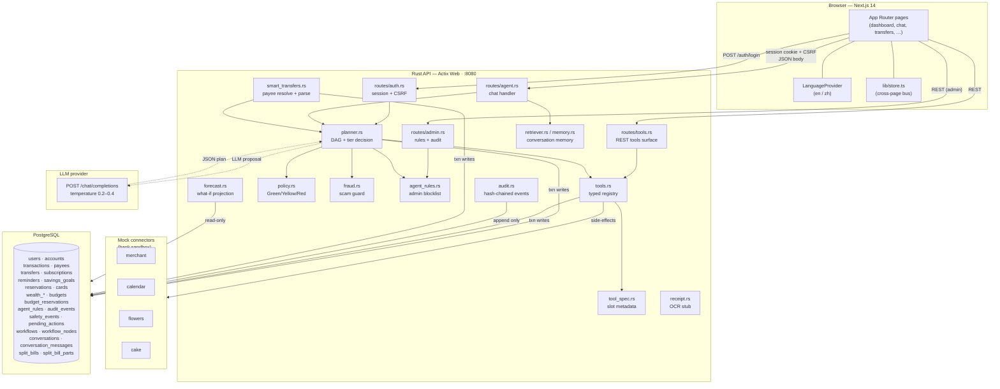
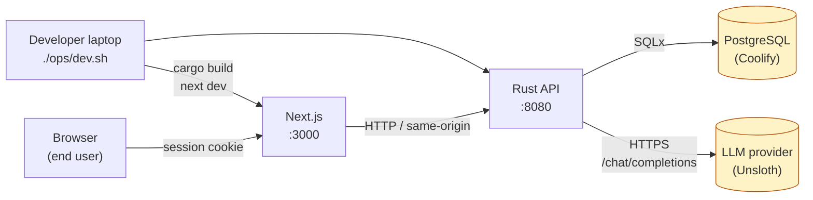

# 0. System Overview

> 中文: [00-系统总览 (中文)](./zh/00-system-overview.md)

FinTech Pioneers is a simulation-only, bilingual AI banking agent. The
**user** chats, asks, or fills a form; the **agent** proposes an
action; the **policy engine** decides whether it is
Green / Yellow / Red; the **executor** either runs it or queues it
for a single-tap / MFA confirmation. **Money never moves outside
the simulator.**

The whole project lives in this repository:

```
bankpilot/
├── backendrust/       Rust + Actix Web API, SQLx, LLM adapter, seed
├── frontend/          Next.js 14 (App Router), React 18, Tailwind, i18n
├── docs/              This documentation tree
├── ops/dev.sh         One-command dev stack
├── .env               Runtime configuration (loaded by ops/dev.sh)
├── .env.example       Template for a fresh checkout
├── PLAN.md            High-level product spec
├── package.json       Root pnpm workspace marker
├── pnpm-lock.yaml
└── FinTech Pioneers_Project_Details_and_Feature_Specification.docx
```

## 0.1 Component map



> **Key.** Solid arrows = synchronous request paths. Dotted arrows
> = outbound calls to the LLM provider. The `DB` block lists every
> production table — see [02-data-model.md](./02-data-model.md) for
> the ER diagram.

## 0.2 What runs where

| Layer | Tech | Port | Source |
|---|---|---|---|
| Frontend | Next.js 14 (App Router) + React 18 + Tailwind | `:3000` | `frontend/` |
| Backend | Rust 2021 + Actix Web 4 + SQLx | `:8080` | `backendrust/` |
| Database | PostgreSQL (external, Coolify) | `:5432` | `DATABASE_URL` |
| LLM provider | OpenAI-compatible HTTP (Unsloth by default) | external | `UNSLOTH_URL`, `UNSLOTH_API_KEY`, `UNSLOTH_MODEL` |
| Mock connectors | In-process Rust functions, no network | — | `backendrust/src/routes/features.rs` and tool registry |

Postgres is **not** packaged in this repo. The dev script points
`DATABASE_URL` at a remote instance (Coolify in production,
`postgres@127.0.0.1` in local dev). Migrations are plain SQL under
`backendrust/migrations/`.

## 0.3 Deployment topology



> Production differs only in that `BACKEND_PORT` and the Postgres
> host move behind a reverse proxy. There is no built-in Docker
> compose — the assumption is the operator already has Postgres
> reachable.

## 0.4 Module responsibilities (high level)

| Module | Responsibility | Source |
|---|---|---|
| `auth` | session cookie, CSRF token, password hashing, safety-lock state | `routes/auth.rs`, `sessions.rs`, `security.rs` |
| `agent` | the chat endpoint: LLM propose → plan → execute | `routes/agent.rs`, `planner.rs` |
| `tools` | the typed registry of side-effectful operations | `tools.rs`, `tool_spec.rs` |
| `policy` | Green / Yellow / Red decision per action | `policy.rs` |
| `fraud` | scam-pattern scoring, narrative generation | `fraud.rs` |
| `agent_rules` | admin-configurable block / restrict / prefix rules | `agent_rules.rs` |
| `forecast` | "can I afford it?" projection | `forecast.rs` |
| `receipt` | receipt/invoice → draft (stub or LLM) | `receipt.rs` |
| `smart_transfers` | payee resolve, free-form transfer parsing, split-bills | `smart_transfers.rs` |
| `planner` | DAG construction, slot filling, escalation, compensation | `planner.rs` |
| `retriever` / `memory` | conversation memory + RAG retriever | `retriever.rs`, `memory.rs` |
| `audit` | append-only hash-chained event log | `audit.rs` |
| `safety` | safety lock state machine, MFA failure backoff | `safety.rs` |
| `llm_http` | single HTTP client, timeouts, retry | `llm_http.rs` |
| `llm` | LLM adapter (provider → Proposal), with regex stub fallback | `llm.rs` |
| `translate` | detector + per-language wording tables for the chat reply | `translate.rs` |
| `seed` | idempotent demo data loader | `seed.rs` |

## 0.5 Where to go next

- Want to follow a single request? → [01-request-lifecycle.md](./01-request-lifecycle.md)
- Want the schema? → [02-data-model.md](./02-data-model.md)
- Want the algorithms? → [03-algorithms.md](./03-algorithms.md)
- Want the frontend tree? → [04-frontend.md](./04-frontend.md)
- Want the dev workflow? → [05-deployment.md](./05-deployment.md)
- Want the security layers? → [06-security-design.md](./06-security-design.md)
