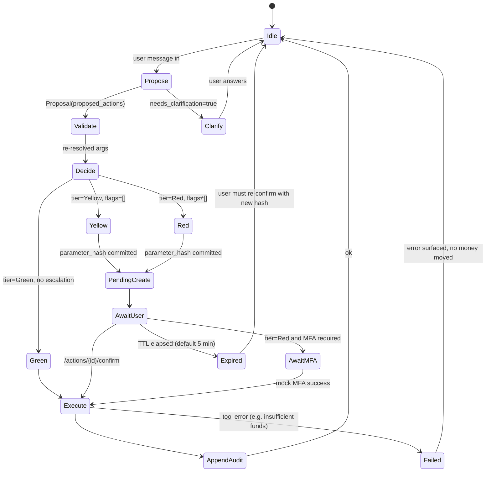
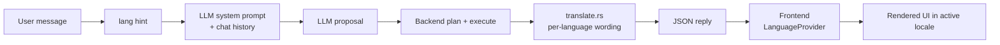

# 1. Request Lifecycle

> 中文: [01-请求生命周期 (中文)](./zh/01-request-lifecycle.md)

Every mutating request — whether from the chat, the `/transfers`
form, the receipt scanner, or the admin console — goes through the
same four stages. **No stage can do another stage's job.** That
separation is what lets the LLM be wrong without money moving.

## 1.1 The four stages

```
   ┌──────────┐    ┌──────────────┐    ┌───────────────┐    ┌──────────────┐
   │  PLAN    │──▶ │   VALIDATE   │──▶ │  AUTHORISE    │──▶ │   EXECUTE    │
   │ (LLM own)│    │ (backend own)│    │ (policy own)  │    │(backend own) │
   └──────────┘    └──────────────┘    └───────────────┘    └──────────────┘
        │                 │                    │                    │
     advisory         authoritative         authoritative         authoritative
     (JSON)           (re-resolved)         (tier + flags)        (side effect)
```

| Stage | Owner | What it produces | Where to read |
|---|---|---|---|
| **Plan** | LLM (Unsloth by default, regex stub on fallback) | `{intent, language, entities, clarification_required, proposed_actions[]}` | `backendrust/src/llm.rs` (adapter), `llm_http.rs` (HTTP client), `llm_audit.rs` (raw-payload log) |
| **Validate** | Backend, the only writer of money fields | Re-resolved `payee_id`, integer `amount_fen`, normalised schedule, validated schema | `backendrust/src/planner.rs::resolve_*`, `tools.rs::t_*`, `tool_spec.rs::validate_arguments` |
| **Authorise** | Policy engine (sole writer of the tier) | `Decision { tier, reason, escalate_from, flags }`; if Yellow/Red, a `pending_actions` row with `parameter_hash` | `backendrust/src/policy.rs::decide_*`, `agent_rules.rs`, `fraud.rs::score_transfer` |
| **Execute** | Backend tool registry | Side effect on Postgres, an updated `transfers`/`subscriptions`/`cards`/… row, an `audit_events` row appended to the hash chain | `backendrust/src/tools.rs::t_transfer_create_pending` and siblings, `audit.rs::append_event` |

The LLM **never** chooses a tier. The tier comes from
`policy::decide_*` plus, when present, the admin rule engine
(`agent_rules.rs`) and the fraud guard (`fraud.rs`).

## 1.2 Sequence — a Yellow-tier transfer

```mermaid
sequenceDiagram
    autonumber
    participant U as User
    participant FE as Browser (Next.js)
    participant AG as routes/agent.rs
    participant LLM as LLM (Unsloth / stub)
    participant PL as planner.rs
    participant POL as policy.rs
    participant FR as fraud.rs
    participant TO as tools.rs
    participant DB as PostgreSQL
    participant AUD as audit.rs

    U->>FE: "转 200 元午饭钱给 Li Wei"
    FE->>AG: POST /api/v1/agent/message {text, session}
    AG->>LLM: propose(text, state_summary)
    LLM-->>AG: Proposal { intent: "transfer",<br/>proposed_actions: [ {tool: "transfer.create_pending",<br/>arguments: {amount_fen: 20000, memo: "午饭钱", recipient_query: "Li Wei"}} ] }
    AG->>PL: build_plan(user, proposal)
    PL->>DB: SELECT * FROM payees WHERE display_name ILIKE 'Li Wei'
    DB-->>PL: payee(payee_id=pay_xyz, verified=false)
    PL->>POL: decide_transfer(user, account, payee, 20000, memo)
    POL->>FR: score_transfer(pool, user, payee, 20000, memo)
    FR-->>POL: flags=[], score=0
    POL-->>PL: Decision { tier: "Yellow", reason: "within_daily_limit" }
    PL->>DB: BEGIN; INSERT pending_actions(parameter_hash=…); COMMIT
    PL-->>AG: PlannedNode { tier: "Yellow",<br/>pending_action_id: "pa_…" }
    AG-->>FE: 200 { needs_confirmation: true,<br/>confirmation_card: { tier, payee, amount_fen, memo, expires_at } }
    U->>FE: tap "Confirm"
    FE->>AG: POST /api/v1/actions/{pa_id}/confirm {parameter_hash}
    AG->>PL: execute_pending(pa_id)
    PL->>TO: t_transfer_create_pending({account_id, payee_id, amount_fen, memo, idempotency_key})
    TO->>DB: BEGIN; SELECT … FOR UPDATE on accounts; UPDATE accounts SET available_balance_fen -= 20000; INSERT transfers; INSERT transactions (debit); UPDATE payees.first_used_at; COMMIT
    TO-->>PL: { transfer_id: "tx_…" }
    PL->>AUD: append_event(action="transfer.confirm", risk_tier="Yellow", result="ok", …)
    AUD->>DB: INSERT audit_events(prev_hash, hash)
    PL-->>AG: ok
    AG-->>FE: 200 { ok: true, transfer_id: "tx_…" }
    FE-->>U: "Done. ¥200.00 to Li Wei."
```

> Notice where the LLM stops. Everything below the **dashed line**
> is server-side and deterministic. The LLM only proposes JSON;
> the server re-resolves every field.

## 1.3 The LLM tool loop — `stateDiagram-v2`

The planner is a small state machine. A request can loop, but the
**monotonicity rule** is enforced: a tier can only escalate, never
downgrade.



> **Monotonicity invariant.** Once a node is Yellow or Red, it cannot
> move back to Green in the same workflow. This is enforced inside
> `planner::decide_node` — there is no `tier: downgraded` codepath.

## 1.4 Where each stage lives in the codebase

| Stage | File | Function |
|---|---|---|
| Plan | `backendrust/src/llm.rs` | `propose_async`, `stub_propose` |
| Plan (HTTP) | `backendrust/src/llm_http.rs` | `propose_unsloth` |
| Plan (audit) | `backendrust/src/llm_audit.rs` | raw payload capture |
| Validate | `backendrust/src/planner.rs` | `resolve_account`, `resolve_payee_by_query`, `coerce_amount_fen` |
| Validate (schema) | `backendrust/src/tool_spec.rs` | `validate_arguments`, `spec_table()` |
| Authorise | `backendrust/src/policy.rs` | `decide_transfer`, `decide_card_action`, `decide_wealth_*`, `decide_budget_*`, `decide_subscription_cancel`, `decide_goal_reservation` |
| Authorise (fraud) | `backendrust/src/fraud.rs` | `score_transfer`, `narrate_scam_flags` |
| Authorise (admin rules) | `backendrust/src/agent_rules.rs` | `forbidden_tools`, `restrict_payee`, `restrict_amount_fen`, `restrict_daily_fen`, `restrict_memo`, `system_prompt_prefix` |
| Execute | `backendrust/src/tools.rs` | `t_transfer_create_pending`, `t_subscription_cancel`, `t_card_*`, `t_budget_*`, `t_reminder_*`, `t_wealth_*`, `t_split_*` |
| Execute (chain) | `backendrust/src/audit.rs` | `append_event`, `last_hash`, `verify_chain` |

## 1.5 Cross-cutting: the bilingual i18n loop

The Plan stage passes the user's `preferred_language` into the LLM
system prompt so the model can mirror the user's wording. The
**authoritative answer** is rendered server-side via
`backendrust/src/translate.rs` (per-language token tables), then
the frontend wraps it in the active locale via `useLanguage()`.
This means **the UI can switch language without re-running the
plan** — only the dictionary lookup swaps.



## 1.6 Failure paths

- **LLM unavailable** → `llm::propose_async` falls through to
  `stub_propose` (regex-based). The stub always returns a valid
  `Proposal`. The user sees a small "offline stub" badge in the
  chat header.
- **Tool fails** (e.g. mock merchant timeout, insufficient funds)
  → the workflow pauses; the user sees a clear error and a "retry"
  affordance. **No partial commit** — every state-changing tool
  runs inside a single Postgres transaction that rolls back on
  error.
- **Pending action expires** (default 5 min) → row marked
  `expired`; the user must re-confirm with a fresh
  `parameter_hash`.
- **Audit write fails** → the state-changing tx rolls back; the
  action is **not** recorded as done.
- **Safety lock triggers mid-workflow** → all in-flight
  Yellow/Red nodes move to `paused`; Green can continue for
  read-only side effects.