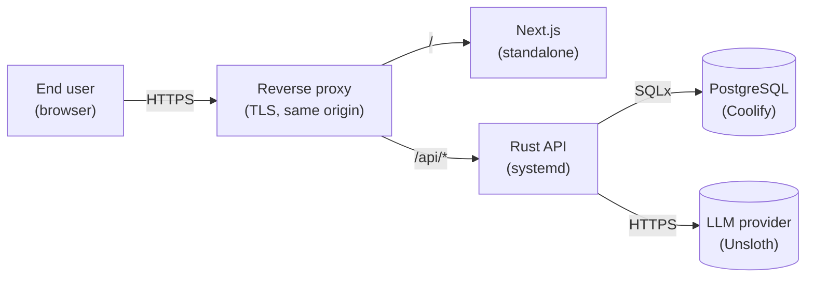

# 5. Deployment

> 中文: [05-部署 (中文)](./zh/05-deployment.md)

FinTech Pioneers is a **two-process** application: a Rust HTTP API and a
Next.js frontend. There is no in-repo Docker compose; Postgres is
external. The dev script starts both processes, tails their logs,
and tears them down on Ctrl-C.

## 5.1 The one command

```bash
./ops/dev.sh
```

This script (`ops/dev.sh`):

1. **Loads `.env` safely.** It uses a strict assignment-only
   loader that only accepts `KEY=VALUE` lines with a valid
   variable name on the left. Lines that look like shell
   commands (e.g. an unquoted space that turns into a command)
   are dropped on purpose. Comments and blank lines are ignored.
2. **Stops any prior runs on `:8080` and `:3000`** by walking
   `ss -tnlp` and `kill`ing the PIDs. Idempotent.
3. **Builds and starts the Rust backend.** If `--build` is
   passed, it does `cargo build --release`. Otherwise it
   one-time `cargo build` (debug) if the binary is missing.
   The backend runs as a child process with logs piped to
   `.run/rust-backend.log`.
4. **Builds and starts the Next.js frontend** in dev mode,
   logs to `.run/frontend.log`. It tries `node_modules/.bin/next`
   first, then `pnpm next`, then `npx --no-install next`.
5. **Waits for both to be ready** (60-iteration 1-second
   loop, `GET /healthz` and `GET /` both returning 200).
6. **Tails both logs** in the foreground until Ctrl-C.
7. **Cleans up** on `INT TERM EXIT` — kills both PIDs and `wait`s.

### 5.1.1 Flags

| Flag | Effect |
|---|---|
| `--build` | Run `cargo build --release` first (slower, then run) |
| `--no-frontend` | Skip the Next.js process |
| `--no-backend` | Skip the Rust process |

### 5.1.2 Environment variables

| Var | Default | Used by |
|---|---|---|
| `DATABASE_URL` | `postgres://postgres@127.0.0.1:5432/bankpilot` (dev) | backend |
| `HOST` / `BANKPILOT_HOST` | `0.0.0.0` | backend bind |
| `PORT` / `BACKEND_PORT` | `8080` | backend bind |
| `FRONTEND_PORT` | `3000` | `next dev` |
| `UNSLOTH_URL` | _(required for live LLM)_ | `llm_http::propose_unsloth` |
| `UNSLOTH_API_KEY` | _(required for live LLM)_ | `llm_http::propose_unsloth` |
| `UNSLOTH_MODEL` | _(required for live LLM)_ | `llm_http::propose_unsloth` |
| `DAILY_LIMIT_FEN` | `5000000` (¥50,000) | `policy::check_daily_limit` |
| `RUST_LOG` | `info` | `env_logger` |
| `DEMO_LANGUAGE` | `en` | seed: which locale to pre-populate |

If any of `UNSLOTH_URL`, `UNSLOTH_API_KEY`, `UNSLOTH_MODEL` is
missing or empty, the LLM is **disabled** and the regex stub is
used. `Settings::unsloth_enabled()` is the single check the
runtime cares about; nothing else in the codebase imports the
provider SDK.

## 5.2 Directory layout at runtime

```
bankpilot/
├── .run/
│   ├── rust-backend.log       Combined stdout + stderr of the API
│   └── frontend.log           Combined stdout + stderr of `next dev`
├── backendrust/
│   └── target/{debug,release}/bankpilot    Built binary
├── frontend/
│   ├── .next/                 Build cache
│   └── node_modules/
└── .env                       Local config (gitignored)
```

`.run/` is created by the dev script. Tail it with:

```bash
tail -f .run/rust-backend.log
tail -f .run/frontend.log
```

## 5.3 The seed

`backendrust/src/seed.rs` runs **on every backend start** but
only writes when the `users` table is empty (`seed_if_empty`).
The deterministic seed (`SEED = 20251016` in the source) creates
two demo accounts, ~150 transactions, 8 payees, 5 subscriptions,
2 cards, 3 wealth products, 2 savings goals, and a fresh admin
user.

To force a re-seed:

```bash
psql "$DATABASE_URL" -c "TRUNCATE users, accounts, transactions, \
   payees, transfers, subscriptions, reminders, savings_goals, \
   reservations, cards, wealth_products, wealth_holdings, \
   conversations, conversation_messages, workflows, workflow_nodes, \
   pending_actions, audit_events, safety_events, agent_rules, \
   budgets, budget_reservations, split_bills, split_bill_parts \
   RESTART IDENTITY CASCADE;"
# then restart the backend
```

## 5.4 Production shape



Differences from dev:

- The frontend is **built** (`next build`) and run as a
  standalone Node server (or via a static export behind the
  proxy if the page count is fixed).
- The Rust API runs under `systemd` (or any supervisor) bound to
  `127.0.0.1`; the reverse proxy terminates TLS.
- Both processes read secrets from a vault, not a `.env` file.
- Postgres is the production Coolify instance; the
  `TRUNCATE … RESTART IDENTITY` recipe is **dev only** and would
  wipe real data — guard it.

## 5.5 Health checks

| Endpoint | What it returns |
|---|---|
| `GET /healthz` | `200` if the process is up and SQLx can `SELECT 1` |
| `GET /` | The landing page (Next.js) |
| `GET /api/v1/health` (when added) | Per-component health for ops dashboards |

`ops/dev.sh` polls `/healthz` and `/` until both return `200`.

## 5.6 Logs and observability

- **Backend** — `env_logger`, default `info`. `info!` is used
  for normal flow (`llm: using Unsloth proposal (intent=…)`,
  `transfer.confirm ok`, `fraud_guard: hard_signal=true`).
  `warn!` is used for soft failures (LLM down, rule match
  blocked). `error!` is for hard failures that need operator
  attention.
- **Frontend** — `console.log/info/warn/error` are picked up by
  `next dev`'s overlay. The `error.tsx` boundary logs
  `error.digest` so a dev can find the same row in the Next
  overlay.
- **Database** — the `audit_events` table is the
  single source of truth for what happened, when, to whom, with
  what policy decision. The hash chain makes any tampering
  detectable. The admin `/admin/audit` page is a UI on top of
  this table.

## 5.7 Restart cycle (the answer to "restart the project")

```bash
# 1. Stop anything on :8080 and :3000 (idempotent)
./ops/dev.sh --no-frontend  # stops backend, restarts it
# or:
./ops/dev.sh --no-backend   # stops frontend, restarts it
# or just:
./ops/dev.sh                # stops and restarts both
```

The script's `stop_listeners` is keyed on the port number, so
running it twice is safe. The trap on `INT TERM EXIT` cleans up
child PIDs even if you Ctrl-C mid-build.

## 5.8 What the dev script does **not** do

- It does **not** run database migrations. Migrations are
  applied at backend start (see `backendrust/src/main.rs`); on
  a fresh database the seed then runs.
- It does **not** open a browser. Open
  <http://127.0.0.1:3000> yourself.
- It does **not** watch the database. If you change a
  migration, restart the backend to re-apply it (or run
  `sqlx migrate run` manually).
- It does **not** validate the LLM URL. If `UNSLOTH_URL` is
  wrong, the chat falls back to the stub silently. Check
  `bankpilot | llm: Unsloth unavailable, falling back to stub`
  in `.run/rust-backend.log`.
