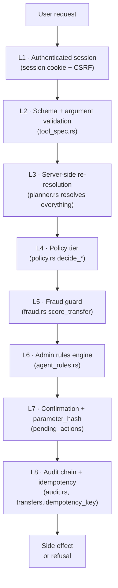

# 6. Security Design

> 中文: [06-安全设计 (中文)](./zh/06-security-design.md)

This page documents the **eight layers of defence in depth** that
FinTech Pioneers applies to every mutating action, and maps each one to
the source file that implements it. It is **complementary to** the
external [Security Self-Assessment](../self-assessment/README.md):

- **This page** is the *design*: what we built, where, and why.
- **The self-assessment** is the *honest list*: what is and is
  not safe to claim, the R-1…R-15 risk register, and the
  non-claims.

If you have 10 minutes, read this page. If you have 30, read both.

## 6.1 The eight layers



> **The layers run in order. Each one can only ADD refusals; no
> layer can override a higher-numbered layer.** L4 is the
> authoritative tier decision; L6 can escalate but never
> downgrade; L7's `parameter_hash` is what makes "user changed
> their mind" an automatic re-confirmation, not a silent
> substitution.

## 6.2 Layer-by-layer

### L1 — Authenticated session

| Aspect | Implementation |
|---|---|
| Cookie name | `bp_session` (HttpOnly, SameSite=Lax) |
| CSRF | double-submit token: `csrfToken` cookie + `X-CSRF-Token` header (`routes/auth.rs`, `ctx.rs`) |
| Password | `security::hash_password` (Argon2id) |
| Session expiry | 24h rolling (`sessions.expires_at`) |
| 401 handling | Frontend `api.ts` clears the session and redirects to `/login` |

### L2 — Schema + argument validation

Every tool call is validated against the static `ToolSpec` in
`backendrust/src/tool_spec.rs` before the planner looks at it.
`validate_arguments` walks the arguments map and reports a list
of missing or wrong-typed slots. The planner surfaces one
clarification question per missing slot.

```rust
// tool_spec.rs
ToolSpec {
    canonical_name: "transfer.create_pending",
    mutating: true,
    default_tier: "Yellow",
    arguments_schema: json!({
        "type": "object",
        "required": ["account_id", "payee_id", "amount_fen"],
        "properties": {
            "account_id": {"type": "string"},
            "payee_id":   {"type": "string"},
            "amount_fen": {"type": "integer", "minimum": 1},
            "memo":       {"type": "string"}
        }
    }),
    required_slots: &[
        SlotSpec { name: "account_id", kind: Identifier, inferable: true, … },
        SlotSpec { name: "payee_id",   kind: Identifier, inferable: true, … },
        SlotSpec { name: "amount_fen", kind: AmountFen,  inferable: true, … },
    ],
    optional_slots: &[
        SlotSpec { name: "memo",       kind: String,     inferable: true, … },
    ],
}
```

### L3 — Server-side re-resolution

The planner never trusts a value from the LLM. Every identifier
is re-resolved against the database using the **session's user
id**, not any value in the request body:

| LLM-supplied | Re-resolved by | Result type |
|---|---|---|
| `recipient_query: "Li Wei"` | `planner::resolve_payee_by_query` | internal `payee_id` |
| `account_id: "acc_abc"` | `planner::resolve_account` (checks `user_id` ownership) | `Account` row |
| `amount_cny: "200"` | `money::coerce_amount_fen` | integer `i64` fen |
| `schedule: "tomorrow"` | parsed with timezone normalisation | RFC 3339 `DateTime<Utc>` |

A LLM-suggested `payee_id` that doesn't exist is rejected
(`ToolError::NotFound`). A LLM-suggested `account_id` belonging
to a different user is rejected the same way — this prevents
horizontal escalation.

### L4 — Policy tier

`backendrust/src/policy.rs` is the **only** file that writes a
risk tier. The decision functions are:

| Function | Tier when clean | What escalates it to Red |
|---|---|---|
| `decide_transfer` | Yellow | non-positive amount, injection phrase, daily limit exceeded, payee flag, urgency, hard-signal scam |
| `decide_card_action` | Yellow (issue/freeze/unfreeze/cancel/limit) or Red (report_lost) | unknown action |
| `decide_wealth_subscribe` | Yellow | `risk_level == "high"`, suitability mismatch |
| `decide_wealth_redeem` | Yellow | — |
| `decide_subscription_cancel` | Yellow | — |
| `decide_goal_reservation` | Yellow | — |
| `decide_budget_set` | Yellow | — |
| `decide_budget_reserve` | Red (default) | moves `available → reserved` |

**Monotonicity** is enforced by the fact that nothing in the
codebase downgrades a tier. `escalate_from: Some("Yellow")` is
informational; it documents *why* the escalation happened, not
a request to lower it later.

### L5 — Fraud guard

`backendrust/src/fraud.rs` is **advice**, not authority. It
produces a list of signals; the policy engine (L4) reads them
and decides the tier. A hard signal — `urgency_words`,
`payee_flagged`, or any flag with `weight ≥ 5` — is the only
case where fraud guard alone escalates a transfer to Red.

The signal list (with weights):

| Code | Weight | Trigger |
|---|---|---|
| `new_payee` | 3 | `payee.first_used_at is null` |
| `unverified_payee` | 4 | `payee.verified == false` |
| `amount_unusual` | 4 | amount > 3× median past transfer to this payee |
| `urgency_words` | 5 | memo matches the bilingual urgency list |
| `payee_flagged` | 5 | payee name matches the static flag list |
| `amount_round` | 1 | amount is a round ¥100+ figure (≥ ¥500) |
| `out_of_pattern` | 3 | post-transfer balance would drop below 30-day expense average |

The narrative LLM call is **never** used for the decision — it
only rephrases the signals for the chat UI. If the LLM fails,
the templated text is the fallback. The score is
`min(100, sum(weights) × 4)`.

### L6 — Admin rules engine

`backendrust/src/agent_rules.rs` is a server-side blocklist that
admins manage from `/admin/rules`. The kinds:

| Kind | What it matches | Default severity |
|---|---|---|
| `forbid_tool` | exact tool canonical name | block |
| `restrict_payee` | substring of `payee.display_name` or `phone_tail` | block |
| `restrict_memo` | regex substring of `memo` (case-insensitive) | block |
| `restrict_amount_fen` | single-transfer cap; amount > N is denied | block |
| `restrict_daily_fen` | daily cumulative cap on the account | block |
| `system_prompt_prefix` | injected as a paragraph at the top of system prompt | warn |

Every match is written to `audit_events` with
`action = 'agent_rule.match'` and the rule id, so the admin
overview can show "rule X fired N times today." A `block` rule
denies the action; a `warn` rule records an audit row but
allows the action.

### L7 — Confirmation + parameter_hash

Yellow and Red tools don't run inline. They create a
`pending_actions` row with an **immutable `parameter_hash`**
(`canonical::parameter_hash` of the canonicalised arguments
map). The user confirms with a `POST /api/v1/actions/{id}/confirm`
that re-hashes the current arguments. If the hash doesn't
match — because the user (or the LLM) changed a number — the
confirmation is rejected with a "your draft has changed"
message and the user must re-confirm with a fresh hash.

This is what makes "the LLM hallucinated a different amount"
a **fail-closed** event: the user sees the new amount and has
to tap confirm again.

Pending actions expire (default 5 minutes) and are GC'd by a
small sweeper. Expired rows are re-createable from the same
chat turn.

### L8 — Audit chain + idempotency

Every state-changing tool writes an `audit_events` row inside
the same Postgres transaction as the mutation. The row's `hash`
is `sha256(canonical_json(..., prev_hash))`. Any tampering —
including a row update — breaks the chain on the next verify.
`audit::verify_chain` walks the table in `O(n)`.

`transfers.idempotency_key` is `UNIQUE`. The transfer tool
issues a new key per call. A retry is a no-op. This is what
makes a double-click on the confirm button safe.

## 6.3 Trust boundaries

| Boundary | Trusted | **Not** trusted |
|---|---|---|
| Browser → API | session cookie, CSRF token, JSON body *shape* | any field value (names, memos, file content) |
| API → LLM | conversation summary, structured user state, tool schema | free-form text from the user or connectors |
| LLM → API | `proposed_actions[]` JSON | LLM's risk assessment, recipient IDs, balances |
| API → connectors | mock connector endpoint, request body | connector response text (sandboxed) |
| Anyone → audit log | read by owner / admin | writes (append-only, backend-only) |

## 6.4 LLM-specific safety

These are the prompt-injection defences. They run **before** the
LLM is ever called and **after** every LLM reply:

- **Memo / merchant sanitisation** — every free-form field is
  wrapped in `<untrusted:N>` placeholders before going into the
  system prompt. The model never sees raw user text in a
  position of authority.
- **Injection phrase blocklist** — `policy::detect_injection`
  scans memos for phrases like `ignore previous`, `transfer all`,
  `system message`, `new instructions`. A match escalates the
  transfer to Red (and the user sees a "this looks like an
  injection attempt" message).
- **Tool name canonicalisation** — `tools::canonicalize_tool_name`
  maps any LLM-suggested tool name to a fixed allowlist. An
  unknown tool is silently dropped.
- **Schema validation** — every tool call is validated against
  the `ToolSpec` before the planner looks at it.
- **Re-resolution** — see L3.
- **Live red-team page** — `/redteam` lets the demo operator
  paste an attack string and see the sanitised `<untrusted:N>`
  view, the phrase that matched, and the resulting tier.

## 6.5 Failure modes the system handles

| Failure | Behaviour | Source |
|---|---|---|
| LLM unavailable | Fall through to regex stub; chat header shows a small "offline stub" badge | `llm::propose_async` |
| Tool fails (e.g. mock timeout) | Workflow pauses; user sees error + retry; no partial commit (single tx) | `planner`, `tools` |
| Pending action expired | Mark `expired`; user re-confirms with a fresh hash | `actions.rs` |
| Audit write fails | State-changing tx rolls back; action not recorded as done | `audit::append_event` |
| Safety lock triggers mid-workflow | All in-flight Yellow/Red nodes move to `paused`; Green can continue for read-only | `safety.rs` |
| Daily limit race | `SELECT … FOR UPDATE` on the account row before the debit | `t_transfer_create_pending` |
| Double-click on confirm | `transfers.idempotency_key UNIQUE`; second insert is a no-op | `transfers` schema + tool code |
| LLM hallucination in amount | `parameter_hash` mismatch at confirm; user sees new amount and re-confirms | `canonical::parameter_hash` + `actions.rs` |

## 6.6 What this page does **not** cover

For the honest list of risks (R-1 through R-15), the non-claims
we make, the threat model, and the banking-API safety matrix,
see:

- [Self-assessment overview](../self-assessment/README.md)
- [Known risks R-1 … R-15](../self-assessment/04-known-risks.md)
- [Non-claims](../self-assessment/05-non-claims.md)
- [Banking & API safety](../self-assessment/07-banking-api-safety.md)
- [LLM safety boundaries](../self-assessment/03-llm-safety.md)
- [Code map (every claim → file)](../self-assessment/06-code-map.md)

## 6.7 Where the security work lives in the codebase

| File | What it owns |
|---|---|
| `backendrust/src/security.rs` | Password hashing, constant-time compare |
| `backendrust/src/sessions.rs` | Session table, expiry, CSRF token |
| `backendrust/src/safety.rs` | Safety lock state machine, MFA failure backoff |
| `backendrust/src/policy.rs` | Risk tier (the only writer) |
| `backendrust/src/fraud.rs` | Scam-guard signals + LLM narrative |
| `backendrust/src/agent_rules.rs` | Admin block / restrict / prefix rules |
| `backendrust/src/audit.rs` | Hash-chained event log |
| `backendrust/src/canonical.rs` | Canonical JSON for `parameter_hash` |
| `backendrust/src/llm_http.rs` | Single HTTP client, timeouts, retry |
| `backendrust/src/llm.rs` | LLM adapter + stub fallback |
| `backendrust/src/redteam.rs` | Live red-team panel + sample attacks |
| `backendrust/src/routes/auth.rs` | Login, MFA, session cookie |
| `backendrust/src/routes/agent.rs` | The chat endpoint (LLM → plan → execute) |
| `backendrust/src/routes/actions.rs` | Pending action confirm / verify |
| `backendrust/src/routes/admin.rs` | Admin panel surface |
| `frontend/src/app/error.tsx` | Global error boundary |
| `frontend/src/components/confirmation-card.tsx` | Yellow/Red confirmation UI |
| `frontend/src/lib/api.ts` | Fetch wrapper, CSRF, 401 handling |
