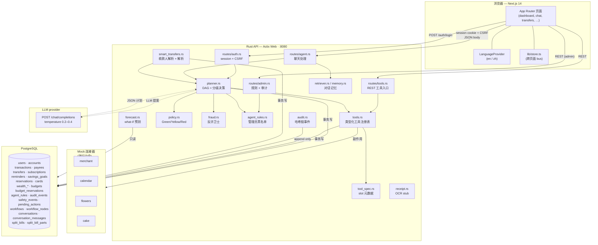
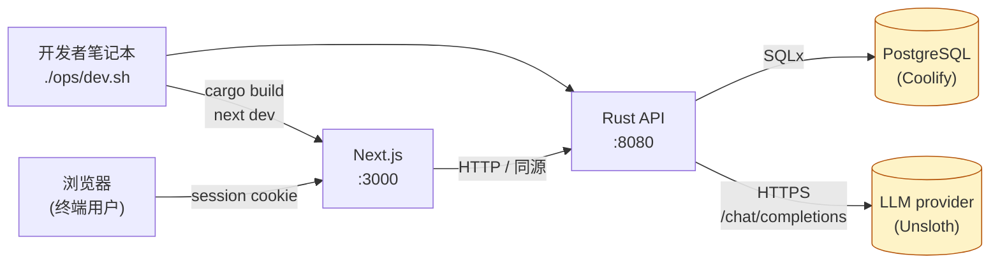

# 0. 系统总览

> English: [00-system-overview.md](../00-system-overview.md)

FinTech Pioneers 是一个**纯模拟**、**双语**的 AI 银行 agent。
**用户**发起聊天、提问或填写表单;**agent**提出动作;
**策略引擎**判定动作属于 Green / Yellow / Red;
**执行器**直接执行或挂起等待单击/MFA 确认。**没有任何真实
资金流出模拟器之外**。

整个项目都在这一个仓库中:

```
bankpilot/
├── backendrust/       Rust + Actix Web API,SQLx,LLM 适配器,seed
├── frontend/          Next.js 14 (App Router),React 18,Tailwind,i18n
├── docs/              本文档
├── ops/dev.sh         一键启动开发环境
├── .env               运行时配置(由 ops/dev.sh 加载)
├── .env.example       干净 checkout 用的模板
├── PLAN.md            高层产品规格
├── package.json       根 pnpm workspace 标记
├── pnpm-lock.yaml
└── FinTech Pioneers_Project_Details_and_Feature_Specification.docx
```

## 0.1 组件图



> **图例.** 实线箭头 = 同步请求路径;虚线箭头 = 对 LLM provider
> 的外发调用。`DB` 块列出了每张生产表 — 详细的 ER 图见
> [02-data-model.md](./02-data-model.md)。

## 0.2 各层运行位置

| 层 | 技术 | 端口 | 源码 |
|---|---|---|---|
| 前端 | Next.js 14 (App Router) + React 18 + Tailwind | `:3000` | `frontend/` |
| 后端 | Rust 2021 + Actix Web 4 + SQLx | `:8080` | `backendrust/` |
| 数据库 | PostgreSQL(外部,Coolify) | `:5432` | `DATABASE_URL` |
| LLM provider | OpenAI 兼容 HTTP(默认 Unsloth) | external | `UNSLOTH_URL`,`UNSLOTH_API_KEY`,`UNSLOTH_MODEL` |
| Mock 连接器 | Rust 进程内函数,无网络 | — | `backendrust/src/routes/features.rs` 与工具注册表 |

Postgres **不**包含在本仓库。开发脚本把 `DATABASE_URL` 指向远程
实例(生产为 Coolify,本地开发为 `postgres@127.0.0.1`)。
迁移文件是普通 SQL,放在 `backendrust/migrations/`。

## 0.3 部署拓扑



> 生产环境的差异仅在于 `BACKEND_PORT` 与 Postgres 主机被放到反向
> 代理之后。本仓库**不带** docker-compose — 默认运维已有可达的
> Postgres。

## 0.4 模块职责(高层)

| 模块 | 职责 | 源码 |
|---|---|---|
| `auth` | session cookie、CSRF token、密码哈希、安全锁状态 | `routes/auth.rs`,`sessions.rs`,`security.rs` |
| `agent` | 聊天端点:LLM 提案 → 规划 → 执行 | `routes/agent.rs`,`planner.rs` |
| `tools` | 类型化、有副作用的操作注册表 | `tools.rs`,`tool_spec.rs` |
| `policy` | 每个动作的 Green / Yellow / Red 决策 | `policy.rs` |
| `fraud` | 诈骗模式打分,生成叙述 | `fraud.rs` |
| `agent_rules` | 管理员可配置的 block / restrict / prefix 规则 | `agent_rules.rs` |
| `forecast` | "我负担得起吗?" 预测 | `forecast.rs` |
| `receipt` | 收据/发票 → 草稿(stub 或 LLM) | `receipt.rs` |
| `smart_transfers` | 收款人解析、自由文本转账解析、分账 | `smart_transfers.rs` |
| `planner` | DAG 构建、slot 填写、升级、补偿 | `planner.rs` |
| `retriever` / `memory` | 对话记忆 + RAG 检索 | `retriever.rs`,`memory.rs` |
| `audit` | 追加式、哈希链事件日志 | `audit.rs` |
| `safety` | 安全锁状态机、MFA 失败退避 | `safety.rs` |
| `llm_http` | 单一 HTTP 客户端,超时与重试 | `llm_http.rs` |
| `llm` | LLM 适配器(provider → Proposal),带正则 stub 兜底 | `llm.rs` |
| `translate` | 聊天回复的检测器 + 多语言词表 | `translate.rs` |
| `seed` | 幂等演示数据装载 | `seed.rs` |

## 0.5 接下来读哪里

- 想跟踪单次请求? → [01-request-lifecycle.md](./01-request-lifecycle.md)
- 想看 schema? → [02-data-model.md](./02-data-model.md)
- 想看算法? → [03-algorithms.md](./03-algorithms.md)
- 想看前端树? → [04-frontend.md](./04-frontend.md)
- 想看开发工作流? → [05-deployment.md](./05-deployment.md)
- 想看安全层? → [06-security-design.md](./06-security-design.md)
