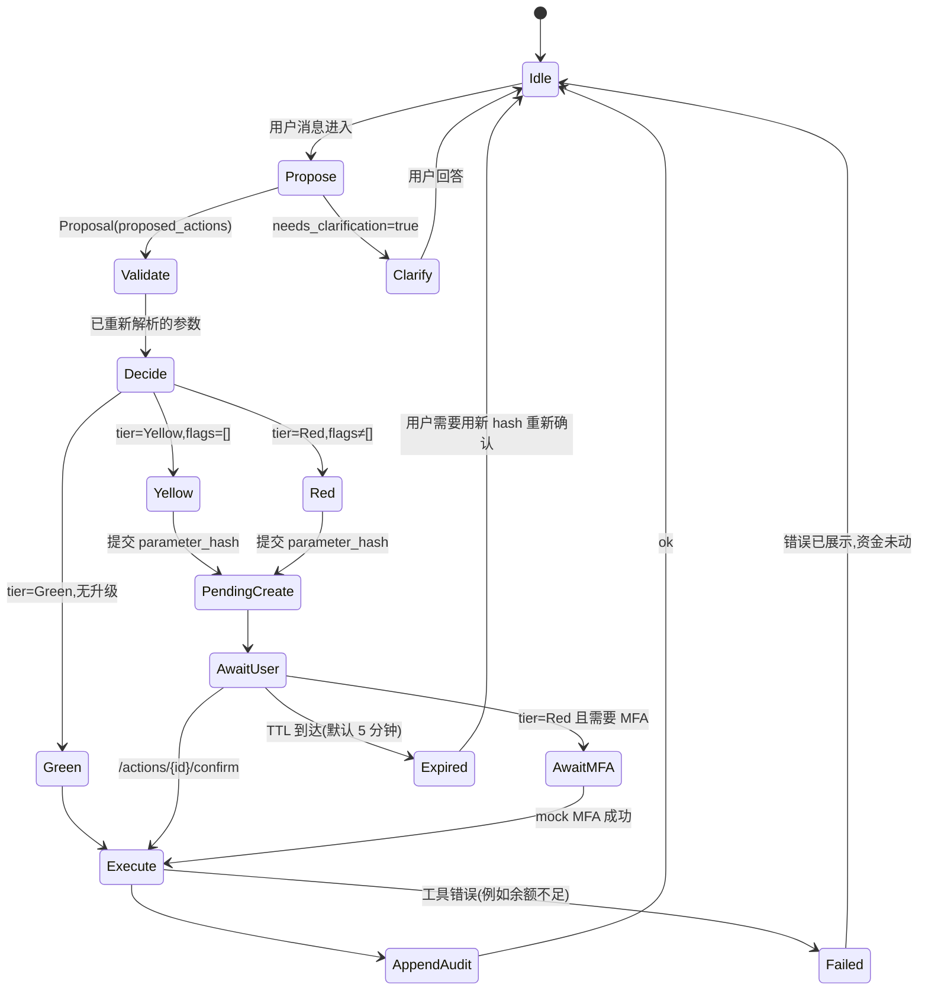
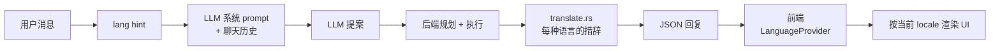

# 1. 请求生命周期

> English: [01-request-lifecycle.md](../01-request-lifecycle.md)

每一个会改变状态的请求 — 不管它来自聊天、`/transfers` 表单、
收据扫描器,还是 admin 控制台 — 都会经过相同的四个阶段。
**任何阶段都不能做其他阶段的事。**正是这种分离,使得 LLM
出错了也不会让钱真的转出去。

## 1.1 四个阶段

```
   ┌──────────┐    ┌──────────────┐    ┌───────────────┐    ┌──────────────┐
   │  规划    │──▶ │    校验      │──▶ │    授权       │──▶ │    执行      │
   │ (LLM 主导)│    │(后端主导)    │    │(策略主导)     │    │(后端主导)   │
   └──────────┘    └──────────────┘    └───────────────┘    └──────────────┘
        │                 │                    │                    │
     建议性            权威性               权威性               权威性
     (JSON)          (重新解析)         (分级 + 标记)            (副作用)
```

| 阶段 | 主导 | 产出 | 源代码 |
|---|---|---|---|
| **规划(Plan)** | LLM(默认 Unsloth,失败时回退到 regex stub) | `{intent, language, entities, clarification_required, proposed_actions[]}` | `backendrust/src/llm.rs`(适配器),`llm_http.rs`(HTTP 客户端),`llm_audit.rs`(原始 payload 日志) |
| **校验(Validate)** | 后端,金额字段的唯一写入方 | 重新解析后的 `payee_id`、整数 `amount_fen`、归一化的 schedule、已校验的 schema | `backendrust/src/planner.rs::resolve_*`、`tools.rs::t_*`、`tool_spec.rs::validate_arguments` |
| **授权(Authorise)** | 策略引擎(分级的唯一写入方) | `Decision { tier, reason, escalate_from, flags }`;若 Yellow/Red,创建带 `parameter_hash` 的 `pending_actions` 行 | `backendrust/src/policy.rs::decide_*`、`agent_rules.rs`、`fraud.rs::score_transfer` |
| **执行(Execute)** | 后端工具注册表 | Postgres 副作用,更新的 `transfers`/`subscriptions`/`cards`/… 行,追加到哈希链的 `audit_events` 行 | `backendrust/src/tools.rs::t_transfer_create_pending` 等,`audit.rs::append_event` |

LLM **永远不会**自己选分级。分级由 `policy::decide_*` 决定,
并在有管理员规则(`agent_rules.rs`)与反诈卫士(`fraud.rs`)
存在时叠加。

## 1.2 序列 — 一笔 Yellow 级转账

```mermaid
sequenceDiagram
    autonumber
    participant U as 用户
    participant FE as 浏览器(Next.js)
    participant AG as routes/agent.rs
    participant LLM as LLM(Unsloth / stub)
    participant PL as planner.rs
    participant POL as policy.rs
    participant FR as fraud.rs
    participant TO as tools.rs
    participant DB as PostgreSQL
    participant AUD as audit.rs

    U->>FE: "转 200 元午饭钱给李伟"
    FE->>AG: POST /api/v1/agent/message {text, session}
    AG->>LLM: propose(text, state_summary)
    LLM-->>AG: Proposal { intent: "transfer",<br/>proposed_actions: [ {tool: "transfer.create_pending",<br/>arguments: {amount_fen: 20000, memo: "午饭钱", recipient_query: "李伟"}} ] }
    AG->>PL: build_plan(user, proposal)
    PL->>DB: SELECT * FROM payees WHERE display_name ILIKE '李伟'
    DB-->>PL: payee(payee_id=pay_xyz, verified=false)
    PL->>POL: decide_transfer(user, account, payee, 20000, memo)
    POL->>FR: score_transfer(pool, user, payee, 20000, memo)
    FR-->>POL: flags=[], score=0
    POL-->>PL: Decision { tier: "Yellow", reason: "within_daily_limit" }
    PL->>DB: BEGIN; INSERT pending_actions(parameter_hash=…); COMMIT
    PL-->>AG: PlannedNode { tier: "Yellow",<br/>pending_action_id: "pa_…" }
    AG-->>FE: 200 { needs_confirmation: true,<br/>confirmation_card: { tier, payee, amount_fen, memo, expires_at } }
    U->>FE: 点击 "确认"
    FE->>AG: POST /api/v1/actions/{pa_id}/confirm {parameter_hash}
    AG->>PL: execute_pending(pa_id)
    PL->>TO: t_transfer_create_pending({account_id, payee_id, amount_fen, memo, idempotency_key})
    TO->>DB: BEGIN; SELECT … FOR UPDATE on accounts; UPDATE accounts SET available_balance_fen -= 20000; INSERT transfers; INSERT transactions (debit); UPDATE payees.first_used_at; COMMIT
    TO-->>PL: { transfer_id: "tx_…" }
    PL->>AUD: append_event(action="transfer.confirm", risk_tier="Yellow", result="ok", …)
    AUD->>DB: INSERT audit_events(prev_hash, hash)
    PL-->>AG: ok
    AG-->>FE: 200 { ok: true, transfer_id: "tx_…" }
    FE-->>U: "完成。已向李伟支付 ¥200.00。"
```

> 请注意 LLM 在哪里停下。**虚线**以下都是服务端、确定性的。
> LLM 只产出 JSON;服务端会重新解析每一个字段。

## 1.3 LLM 工具循环 — `stateDiagram-v2`

规划器是一台小型状态机。请求可以循环,但**单调性规则**得到
强制保证:分级只能升级,不能降级。



> **单调性不变量.** 一旦一个节点是 Yellow 或 Red,就不能在同
> 一个工作流里回到 Green。这点在 `planner::decide_node` 内
> 强制 — 代码中不存在 `tier: downgraded` 路径。

## 1.4 各阶段在代码中的位置

| 阶段 | 文件 | 函数 |
|---|---|---|
| 规划 | `backendrust/src/llm.rs` | `propose_async`、`stub_propose` |
| 规划(HTTP) | `backendrust/src/llm_http.rs` | `propose_unsloth` |
| 规划(审计) | `backendrust/src/llm_audit.rs` | 原始 payload 捕获 |
| 校验 | `backendrust/src/planner.rs` | `resolve_account`、`resolve_payee_by_query`、`coerce_amount_fen` |
| 校验(schema) | `backendrust/src/tool_spec.rs` | `validate_arguments`、`spec_table()` |
| 授权 | `backendrust/src/policy.rs` | `decide_transfer`、`decide_card_action`、`decide_wealth_*`、`decide_budget_*`、`decide_subscription_cancel`、`decide_goal_reservation` |
| 授权(反诈) | `backendrust/src/fraud.rs` | `score_transfer`、`narrate_scam_flags` |
| 授权(管理员规则) | `backendrust/src/agent_rules.rs` | `forbidden_tools`、`restrict_payee`、`restrict_amount_fen`、`restrict_daily_fen`、`restrict_memo`、`system_prompt_prefix` |
| 执行 | `backendrust/src/tools.rs` | `t_transfer_create_pending`、`t_subscription_cancel`、`t_card_*`、`t_budget_*`、`t_reminder_*`、`t_wealth_*`、`t_split_*` |
| 执行(哈希链) | `backendrust/src/audit.rs` | `append_event`、`last_hash`、`verify_chain` |

## 1.5 横切关注点:双语 i18n 循环

规划阶段把用户的 `preferred_language` 传进 LLM 系统 prompt,
让模型能跟随用户的措辞。**权威答复**由
`backendrust/src/translate.rs`(每种语言的 token 表)渲染,
然后前端通过 `useLanguage()` 按当前 locale 包装。这意味着
**前端切换语言不需要重跑规划** — 只换字典查表。



## 1.6 失败路径

- **LLM 不可用** → `llm::propose_async` 回退到 `stub_propose`
  (基于正则)。stub 总会返回一份有效的 `Proposal`。聊天头部会
  出现一个小的"离线 stub"标识。
- **工具失败**(例如 mock 商户超时、余额不足)→ 工作流暂停;
  用户看到清晰的错误和"重试"按钮。**没有部分提交** — 每个
  状态变更工具都在一个 Postgres 事务里执行,出错即回滚。
- **挂起动作过期**(默认 5 分钟)→ 标记为 `expired`;用户必须
  用新的 `parameter_hash` 重新确认。
- **审计写入失败** → 状态变更事务回滚;该动作**不会**被记
  录为已完成。
- **工作流中途触发安全锁** → 所有进行中的 Yellow/Red 节点
  移到 `paused`;Green 可以继续执行只读副作用。
