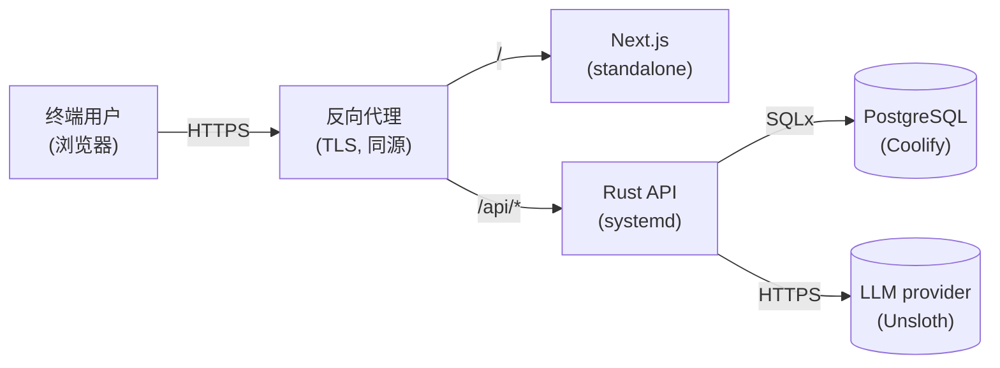

# 5. 部署

> English: [05-deployment.md](../05-deployment.md)

FinTech Pioneers 是一个**两进程**应用:Rust HTTP API 与 Next.js 前端。
仓库里不带 docker-compose;Postgres 是外部的。开发脚本负责
启动两个进程、跟踪日志、在 Ctrl-C 时清理。

## 5.1 一行命令

```bash
./ops/dev.sh
```

`ops/dev.sh` 流程:

1. **安全加载 `.env`。** 使用严格的"仅赋值"加载器,只接受左侧
   是合法变量名的 `KEY=VALUE` 行。看起来像 shell 命令的行
   (例如某个没加引号的空格把 `UNSLOTH_URL=…` 变成命令)会被
   主动丢弃。注释与空行被忽略。
2. **停掉 `:8080` 与 `:3000` 上之前的进程**(通过遍历
   `ss -tnlp` 并 `kill`)。幂等。
3. **构建并启动 Rust 后端。** 传 `--build` 时先
   `cargo build --release`;否则若二进制不存在就一次性
   `cargo build`(debug)。后端作为子进程运行,日志写到
   `.run/rust-backend.log`。
4. **构建并启动 Next.js 前端** (dev 模式),日志写到
   `.run/frontend.log`。依次尝试 `node_modules/.bin/next`、
   `pnpm next`、`npx --no-install next`。
5. **等待两者就绪**(60 次 1 秒循环,`GET /healthz` 与
   `GET /` 都返回 200)。
6. **在前景 tail 两份日志**,直到 Ctrl-C。
7. **清理** — 响应 `INT TERM EXIT`,kill 两个 PID 并 `wait`。

### 5.1.1 标志

| 标志 | 效果 |
|---|---|
| `--build` | 先跑 `cargo build --release`(更慢,然后运行) |
| `--no-frontend` | 跳过 Next.js 进程 |
| `--no-backend` | 跳过 Rust 进程 |

### 5.1.2 环境变量

| 变量 | 默认 | 用途 |
|---|---|---|
| `DATABASE_URL` | `postgres://postgres@127.0.0.1:5432/bankpilot`(dev) | 后端 |
| `HOST` / `BANKPILOT_HOST` | `0.0.0.0` | 后端 bind |
| `PORT` / `BACKEND_PORT` | `8080` | 后端 bind |
| `FRONTEND_PORT` | `3000` | `next dev` |
| `UNSLOTH_URL` | _(使用真实 LLM 时必填)_ | `llm_http::propose_unsloth` |
| `UNSLOTH_API_KEY` | _(使用真实 LLM 时必填)_ | `llm_http::propose_unsloth` |
| `UNSLOTH_MODEL` | _(使用真实 LLM 时必填)_ | `llm_http::propose_unsloth` |
| `DAILY_LIMIT_FEN` | `5000000`(¥50,000) | `policy::check_daily_limit` |
| `RUST_LOG` | `info` | `env_logger` |
| `DEMO_LANGUAGE` | `en` | seed:预填哪种 locale |

如果 `UNSLOTH_URL`、`UNSLOTH_API_KEY`、`UNSLOTH_MODEL` 任一缺失
或为空,LLM **被禁用**,使用正则 stub。`Settings::unsloth_enabled()`
是运行时关心的唯一检查;代码库里没有其他地方 import provider SDK。

## 5.2 运行时目录布局

```
bankpilot/
├── .run/
│   ├── rust-backend.log       API 的 stdout + stderr
│   └── frontend.log           `next dev` 的 stdout + stderr
├── backendrust/
│   └── target/{debug,release}/bankpilot    编译产物
├── frontend/
│   ├── .next/                 构建缓存
│   └── node_modules/
└── .env                       本地配置(.gitignore)
```

`.run/` 由开发脚本创建。tail 它的命令:

```bash
tail -f .run/rust-backend.log
tail -f .run/frontend.log
```

## 5.3 Seed

`backendrust/src/seed.rs` 在**每次后端启动时**运行,但只在
`users` 表为空时(`seed_if_empty`)才写数据。确定性 seed
(源码中 `SEED = 20251016`)会创建两个演示账户、约 150 笔
交易、8 个收款人、5 个订阅、2 张卡、3 个财富产品、2 个储蓄
目标,以及一个全新的 admin 用户。

强制重置:

```bash
psql "$DATABASE_URL" -c "TRUNCATE users, accounts, transactions, \
   payees, transfers, subscriptions, reminders, savings_goals, \
   reservations, cards, wealth_products, wealth_holdings, \
   conversations, conversation_messages, workflows, workflow_nodes, \
   pending_actions, audit_events, safety_events, agent_rules, \
   budgets, budget_reservations, split_bills, split_bill_parts \
   RESTART IDENTITY CASCADE;"
# 然后重启后端
```

## 5.4 生产形态



与开发的差异:

- 前端被**构建**(`next build`),作为 standalone Node 服务运行
  (或在反向代理后用 static export,若页面数固定)。
- Rust API 由 `systemd`(或任何 supervisor)托管,bind 到
  `127.0.0.1`;反向代理负责 TLS 终止。
- 两个进程都从 vault 读密钥,而不是 `.env` 文件。
- Postgres 是生产 Coolify 实例;`TRUNCATE … RESTART IDENTITY`
  配方**仅供开发** — 它会抹掉真实数据,要加护栏。

## 5.5 健康检查

| 端点 | 返回 |
|---|---|
| `GET /healthz` | 进程在线且 SQLx 能跑 `SELECT 1` 时返回 `200` |
| `GET /` | 落地页(Next.js) |
| `GET /api/v1/health`(未来) | 各组件健康状态,给运维仪表盘 |

`ops/dev.sh` 会轮询 `/healthz` 与 `/`,直到两者都返回 `200`。

## 5.6 日志与可观测性

- **后端** — `env_logger`,默认 `info`。`info!` 用于正常流
  (`llm: using Unsloth proposal (intent=…)`、`transfer.confirm ok`、
  `fraud_guard: hard_signal=true`)。`warn!` 用于软失败(LLM
  宕、规则匹配被拦)。`error!` 用于需要运维介入的硬错误。
- **前端** — `console.log/info/warn/error` 被 `next dev` 浮层
  捕获。`error.tsx` 边界打印 `error.digest`,dev 可以在 Next
  浮层里 grep 同一行。
- **数据库** — `audit_events` 表是"何时、对谁、做了什么、
   政策决策是什么"的唯一事实来源。哈希链让任何篡改都可
  检测。`/admin/audit` 是这张表的 UI。

## 5.7 重启流程(对"restart the project"的回答)

```bash
# 1. 停掉 :8080 与 :3000 上所有进程(幂等)
./ops/dev.sh --no-frontend  # 停后端,再启动
# 或:
./ops/dev.sh --no-backend   # 停前端,再启动
# 或直接:
./ops/dev.sh                # 同时停并重启两者
```

脚本的 `stop_listeners` 是按端口号匹配 PID,所以跑两遍是安全的。
`INT TERM EXIT` trap 会在中途 Ctrl-C 时也清理子 PID。

## 5.8 开发脚本**不会**做的事

- 它**不**跑数据库迁移。迁移在后端启动时
  (`backendrust/src/main.rs`);在干净的库上,然后跑 seed。
- 它**不**开浏览器。自己去 <http://127.0.0.1:3000>。
- 它**不**监听数据库。如果改了迁移,重启后端让它重跑(或
  手动跑 `sqlx migrate run`)。
- 它**不**校验 LLM URL。若 `UNSLOTH_URL` 配错,聊天会静默
  回退到 stub。检查 `.run/rust-backend.log` 中是否有
  `bankpilot | llm: Unsloth unavailable, falling back to stub`。
