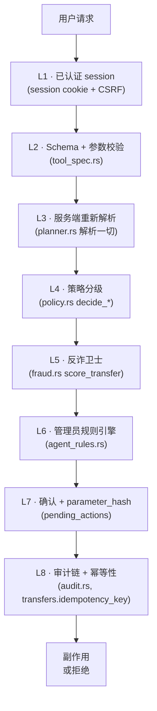

# 6. 安全设计

> English: [06-security-design.md](../06-security-design.md)

本页记录 FinTech Pioneers 对**每一个**会改变状态的动作施加的
**八层纵深防御**,并把每一层对应到实现它的源码文件。本页
与[外部安全自评](../self-assessment/zh/README.md)**互为补充**:

- **本页** 是*设计*:我们建了什么、建在哪里、为什么。
- **自评** 是*诚实的清单*:哪些安全结论可以对外声称、
  R-1…R-15 风险登记表、非声称。

若你只有 10 分钟,先读本页。若有 30 分钟,两份都读。

## 6.1 八层防御



> **各层按序执行。每一层只能增加拒绝;没有一层能覆盖更
> 高编号的层。** L4 是权威的分级决定;L6 可以升级,从不
> 降级;L7 的 `parameter_hash` 让"用户改主意"成为自动的重新
> 确认,而不是静默替换。

## 6.2 逐层

### L1 — 已认证 session

| 项 | 实现 |
|---|---|
| Cookie 名 | `bp_session`(HttpOnly, SameSite=Lax) |
| CSRF | double-submit token:`csrfToken` cookie + `X-CSRF-Token` header(`routes/auth.rs`,`ctx.rs`) |
| 密码 | `security::hash_password`(Argon2id) |
| Session 过期 | 24h 滚动(`sessions.expires_at`) |
| 401 处理 | 前端 `api.ts` 清空 session 并跳到 `/login` |

### L2 — Schema + 参数校验

每一个工具调用在 planner 看到它之前,都要对照
`backendrust/src/tool_spec.rs` 的静态 `ToolSpec` 校验。
`validate_arguments` 遍历 arguments map,返回缺失或类型
不匹配的 slot 列表。Planner 对每个缺失的 slot 抛出一个
澄清问题。

```rust
// tool_spec.rs
ToolSpec {
    canonical_name: "transfer.create_pending",
    mutating: true,
    default_tier: "Yellow",
    arguments_schema: json!({
        "type": "object",
        "required": ["account_id", "payee_id", "amount_fen"],
        "properties": {
            "account_id": {"type": "string"},
            "payee_id":   {"type": "string"},
            "amount_fen": {"type": "integer", "minimum": 1},
            "memo":       {"type": "string"}
        }
    }),
    required_slots: &[
        SlotSpec { name: "account_id", kind: Identifier, inferable: true, … },
        SlotSpec { name: "payee_id",   kind: Identifier, inferable: true, … },
        SlotSpec { name: "amount_fen", kind: AmountFen,  inferable: true, … },
    ],
    optional_slots: &[
        SlotSpec { name: "memo",       kind: String,     inferable: true, … },
    ],
}
```

### L3 — 服务端重新解析

Planner 从不信任 LLM 的值。每个标识符都按**当前 session
的 user id**(而不是请求体里的任何字段)对数据库重新解析:

| LLM 给的 | 由谁重新解析 | 结果类型 |
|---|---|---|
| `recipient_query: "李伟"` | `planner::resolve_payee_by_query` | 内部 `payee_id` |
| `account_id: "acc_abc"` | `planner::resolve_account`(校验 `user_id` 归属) | `Account` 行 |
| `amount_cny: "200"` | `money::coerce_amount_fen` | 整数 `i64` fen |
| `schedule: "tomorrow"` | 解析时区归一 | RFC 3339 `DateTime<Utc>` |

LLM 给的 `payee_id` 若不存在,被拒绝(`ToolError::NotFound`)。
LLM 给的 `account_id` 若属于别的用户,同样被拒绝 — 这防止了
横向越权。

### L4 — 策略分级

`backendrust/src/policy.rs` 是**唯一**写入风险分级的文件。
决策函数:

| 函数 | 干净情况下的分级 | 升级到 Red 的条件 |
|---|---|---|
| `decide_transfer` | Yellow | 非正金额、注入短语、日上限突破、收款人 flag、紧急词、硬信号反诈 |
| `decide_card_action` | Yellow(issue/freeze/unfreeze/cancel/limit)或 Red(report_lost) | 未知动作 |
| `decide_wealth_subscribe` | Yellow | `risk_level == "high"`,适当性不匹配 |
| `decide_wealth_redeem` | Yellow | — |
| `decide_subscription_cancel` | Yellow | — |
| `decide_goal_reservation` | Yellow | — |
| `decide_budget_set` | Yellow | — |
| `decide_budget_reserve` | Red(默认) | 把 `available → reserved` |

**单调性**靠"代码库里没有东西会降级分级"来保证。
`escalate_from: Some("Yellow")` 是信息性的,记录*为什么*发生
了升级,而不是请求以后再降低。

### L5 — 反诈卫士

`backendrust/src/fraud.rs` 是**建议**,不是权威。它产出一组
信号;策略引擎(L4)读取它们并决定分级。**唯一**反诈卫士
单独把转账升级到 Red 的情况是出现了硬信号 —
`urgency_words`、`payee_flagged` 或任一 `weight ≥ 5` 的 flag。

信号列表(带权重):

| 编码 | 权重 | 触发条件 |
|---|---|---|
| `new_payee` | 3 | `payee.first_used_at is null` |
| `unverified_payee` | 4 | `payee.verified == false` |
| `amount_unusual` | 4 | 金额 > 该收款人历史中位数的 3 倍 |
| `urgency_words` | 5 | memo 命中双语紧急词表 |
| `payee_flagged` | 5 | 收款人名命中静态 flag 列表 |
| `amount_round` | 1 | 金额是 ≥ ¥500 的整百(及以上)数字 |
| `out_of_pattern` | 3 | 转账后余额会跌破 30 天支出均值 |

LLM 叙述调用**从不**用于决策 — 它只是把信号重新表述给
聊天 UI。若 LLM 失败,用模板化文本兜底。分数为
`min(100, sum(weights) × 4)`。

### L6 — 管理员规则引擎

`backendrust/src/agent_rules.rs` 是服务端黑名单,管理员在
`/admin/rules` 里管理。规则类型:

| 类型 | 匹配什么 | 默认严重度 |
|---|---|---|
| `forbid_tool` | 工具 canonical name 完全匹配 | block |
| `restrict_payee` | `payee.display_name` 或 `phone_tail` 的子串 | block |
| `restrict_memo` | `memo` 的正则子串(大小写不敏感) | block |
| `restrict_amount_fen` | 单笔上限;金额 > N 即拒绝 | block |
| `restrict_daily_fen` | 账户日累计上限 | block |
| `system_prompt_prefix` | 作为段落注入到系统 prompt 顶部 | warn |

每一次匹配都会写入 `audit_events`,`action = 'agent_rule.match'`
并带上规则 id,这样 admin 总览可以显示"规则 X 今天触发了
N 次"。`block` 规则拒绝该动作;`warn` 规则记一条审计但
放行。

### L7 — 确认 + parameter_hash

Yellow 与 Red 工具不直接执行。它们创建一条 `pending_actions`
记录,带上**不可变的 `parameter_hash`**(`canonical::parameter_hash`
对 canonicalised arguments map 求值)。用户通过
`POST /api/v1/actions/{id}/confirm` 确认,服务端重算当前
arguments 的 hash。若 hash 不一致 — 因为用户(或 LLM)改了
某个数字 — 确认被拒绝,返回"你的草稿已变更",用户必须用
新的 hash 重新确认。

这就是"LLM 幻读出不同金额"成为**fail-closed**事件的根因:
用户看到新金额,得再次点确认。

挂起动作有 TTL(默认 5 分钟),由一个小型 sweeper 回收。
过期行可以从同一聊天轮次中重建。

### L8 — 审计链 + 幂等性

每一个状态变更工具在与 mutation 同一个 Postgres 事务里写
一条 `audit_events` 记录。这一行的 `hash` 是
`sha256(canonical_json(..., prev_hash))`。任何篡改 — 包括
行级 update — 都会在下一次 verify 时打断链。
`audit::verify_chain` 沿表做 O(n) 遍历。

`transfers.idempotency_key` 是 `UNIQUE`。转账工具每次调用发
一个新 key。retry 是 no-op。这是双击确认按钮安全的原因。

## 6.3 信任边界

| 边界 | 信任 | **不**信任 |
|---|---|---|
| 浏览器 → API | session cookie、CSRF token、JSON body *结构* | 任何字段值(姓名、memo、文件内容) |
| API → LLM | 对话摘要、结构化用户状态、工具 schema | 用户/连接器的自由文本 |
| LLM → API | `proposed_actions[]` JSON | LLM 的风险评估、收款人 ID、余额 |
| API → 连接器 | mock 连接器端点、请求体 | 连接器响应文本(沙箱化) |
| 任何人 → 审计日志 | owner / admin 可读 | 写入(只追加,仅后端) |

## 6.4 LLM 专属安全

这些是提示注入的防御措施。它们在**调用 LLM 之前**和**每
次 LLM 回复之后**都会跑:

- **Memo / 商户清洗** — 每一个自由文本字段在被送进系统
  prompt 之前都被包裹在 `<untrusted:N>` 占位符里。模型永远
  不会在权威位置上看到原始用户文本。
- **注入短语黑名单** — `policy::detect_injection` 扫描 memo
  是否有 `ignore previous`、`transfer all`、`system message`、
  `new instructions` 之类的短语。命中则把转账升级到 Red(且
  用户看到一条"这看起来像注入尝试"的消息)。
- **工具名规范化** — `tools::canonicalize_tool_name` 把
  LLM 建议的任何工具名映射到固定的 allowlist。未知工具被
  静默丢弃。
- **Schema 校验** — 每一个工具调用在 planner 看到它之前,
  都对照 `ToolSpec` 校验。
- **重新解析** — 见 L3。
- **实时 red-team 页面** — `/redteam` 让演示操作者粘贴一段
  攻击字符串,看到清洗后的 `<untrusted:N>` 视图、命中的
  短语,以及最终的分级。

## 6.5 系统能处理的失败模式

| 失败 | 行为 | 源码 |
|---|---|---|
| LLM 不可用 | 回退到 regex stub;聊天头部显示一个小的"离线 stub" 标识 | `llm::propose_async` |
| 工具失败(例如 mock 超时) | 工作流暂停;用户看到错误 + 重试;无部分提交(单事务) | `planner`,`tools` |
| 挂起动作过期 | 标记为 `expired`;用户用新 hash 重新确认 | `actions.rs` |
| 审计写入失败 | 状态变更事务回滚;动作不记为完成 | `audit::append_event` |
| 工作流中途触发安全锁 | 所有进行中的 Yellow/Red 节点移到 `paused`;Green 可继续执行只读 | `safety.rs` |
| 日上限竞争 | 借记前 `SELECT … FOR UPDATE` 锁住账户行 | `t_transfer_create_pending` |
| 双击确认 | `transfers.idempotency_key UNIQUE`;第二次插入是 no-op | `transfers` schema + 工具代码 |
| LLM 在金额上幻读 | 确认时 `parameter_hash` 不一致;用户看到新金额并重新确认 | `canonical::parameter_hash` + `actions.rs` |

## 6.6 本页**不**包含的内容

想看诚实的风险清单(R-1 到 R-15)、非声称、威胁模型与银行
API 安全矩阵,请参考:

- [自评总览](../self-assessment/zh/README.md)
- [已知风险 R-1 … R-15](../self-assessment/zh/04-known-risks.md)
- [非声称](../self-assessment/zh/05-non-claims.md)
- [银行与 API 安全](../self-assessment/zh/07-banking-api-safety.md)
- [LLM 安全边界](../self-assessment/zh/03-llm-safety.md)
- [代码索引(每条结论 → 文件)](../self-assessment/zh/06-code-map.md)

## 6.7 安全相关代码在仓库中的位置

| 文件 | 职责 |
|---|---|
| `backendrust/src/security.rs` | 密码哈希、常量时间比较 |
| `backendrust/src/sessions.rs` | session 表、过期、CSRF token |
| `backendrust/src/safety.rs` | 安全锁状态机、MFA 失败退避 |
| `backendrust/src/policy.rs` | 风险分级(唯一的写入方) |
| `backendrust/src/fraud.rs` | 反诈信号 + LLM 叙述 |
| `backendrust/src/agent_rules.rs` | 管理员 block / restrict / prefix 规则 |
| `backendrust/src/audit.rs` | 哈希链事件日志 |
| `backendrust/src/canonical.rs` | `parameter_hash` 的 canonical JSON |
| `backendrust/src/llm_http.rs` | 单一 HTTP 客户端,超时与重试 |
| `backendrust/src/llm.rs` | LLM 适配器 + stub 兜底 |
| `backendrust/src/redteam.rs` | 实时 red-team 面板 + 示例攻击 |
| `backendrust/src/routes/auth.rs` | 登录、MFA、session cookie |
| `backendrust/src/routes/agent.rs` | 聊天端点(LLM → 规划 → 执行) |
| `backendrust/src/routes/actions.rs` | 挂起动作的 confirm / verify |
| `backendrust/src/routes/admin.rs` | 管理面板入口 |
| `frontend/src/app/error.tsx` | 全局错误边界 |
| `frontend/src/components/confirmation-card.tsx` | Yellow/Red 确认 UI |
| `frontend/src/lib/api.ts` | fetch 包装、CSRF、401 处理 |
