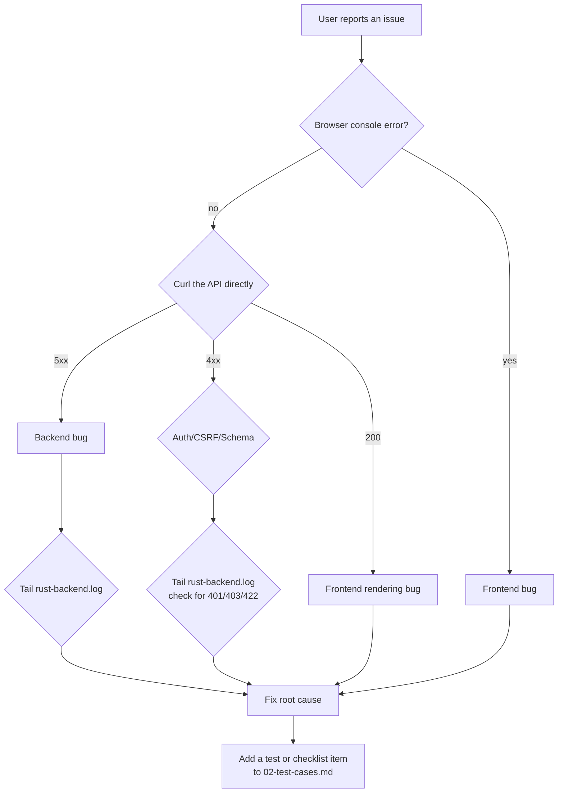

# 1. Troubleshooting

> 中文: [01-故障排查 (中文)](./zh/01-troubleshooting.md)

The other docs describe how the system *should* work. This
page describes what to do when it *doesn't*. Each section names
the symptom, the first log line to grep, the most likely cause,
and the recovery command.

## 1.1 Triage order



The three things to check first, **in order**:

1. `GET /healthz` — if it doesn't return `200`, the process is
   dead or the DB is unreachable. Everything else is moot.
2. `tail -f /var/log/fintech-pioneers/api.log` — most failures
   log a structured `level=…` line with a request id.
3. `tail -f /var/log/fintech-pioneers/web.log` — Next.js logs
   HMR errors, missing imports, and the `error.tsx` boundary
   digest.

## 1.2 Symptom → cause → fix

### 1.2.1 `/healthz` returns 502 or times out

| First log line | Most likely cause | Fix |
|---|---|---|
| `connection refused` (in API log) | API not running | `systemctl status fintech-pioneers-api`; `journalctl -u fintech-pioneers-api -n 50` |
| `sqlx: error returned from database: FATAL: password authentication failed for user "fintech"` | `DATABASE_URL` wrong or password rotated | `sudo -u postgres psql -c "\password fintech"`; update `/etc/fintech-pioneers/api.env`; `systemctl restart fintech-pioneers-api` |
| `sqlx: error returned from database: FATAL: database "bankpilot" does not exist` | DB not created | `sudo -u postgres psql -c "CREATE DATABASE bankpilot OWNER fintech;"` |
| `connection to server …:5432 refused` | Postgres not running | `systemctl status postgresql` |
| `TLS error` on the proxy | Cert expired | `certbot renew`; `nginx -t && systemctl reload nginx` |
| `EADDRINUSE 0.0.0.0:8080` | A stale process is on the port | `ss -tnlp 'sport = :8080'`; `kill <pid>`; restart unit |

### 1.2.2 `GET /` returns 200 but every page is blank

| First log line | Cause | Fix |
|---|---|---|
| `Module not found: Can't resolve '@/i18n/LanguageProvider'` (frontend log) | Missing import after a partial edit | Add the import; HMR will rebuild. The Next.js `error.tsx` boundary catches this as "SOMETHING BROKE" — fix the import and the boundary releases. |
| `Hydration mismatch` | Server-rendered HTML differs from first client render | Most common: `localStorage` is read in render. Move the read to `useEffect`. The LanguageProvider already does this; new code should follow the same pattern. |
| `TypeError: t is not a function` | A page uses `useT()` outside `<LanguageProvider>` | Wrap the page in the provider (it lives in `app/layout.tsx`) or pull `t` from `useLanguage()` if you're already inside a sub-tree. |

### 1.2.3 Login fails with "Invalid CSRF token"

| Cause | Fix |
|---|---|
| The browser is on `http://` but the cookie was set with `Secure; SameSite=Lax` over `https://` | The reverse proxy must set `X-Forwarded-Proto https` (the nginx config above does this). |
| Two tabs, one of which is on a different origin | The session cookie is single-origin. Use one tab. |
| The session expired (24h) | Log in again. |

### 1.2.4 `chat` page hangs forever

| First log line | Cause | Fix |
|---|---|---|
| `llm: Unsloth unavailable, falling back to stub` | `UNSLOTH_URL`/`UNSLOTH_API_KEY` wrong or the LLM is down | Verify the env vars; curl the LLM URL from the host. The stub always returns a proposal; the chat should still work, just with less polished copy. |
| `error sending request for url (…)` | Network/DNS problem reaching the LLM | Same as above; check `curl -v "$UNSLOTH_URL"` from the API host. |
| `propose_unsloth: timeout` | LLM slow / hanging | The `llm_http` client has a timeout; if it's too short, raise it in `Settings`. The chat will fall through to the stub and the user sees the small "offline stub" badge. |
| `parse error: expected value` | LLM returned non-JSON | The proposal parser fails. The stub takes over; the user sees a generic reply. |

### 1.2.5 Transfer confirm returns "your draft has changed"

This is the **expected** behaviour — the `parameter_hash` no
longer matches because the LLM proposal (or the user) changed a
value between plan and confirm. Nothing to fix; ask the user to
re-confirm. If it happens every time:

- The chat is producing a different plan each refresh. The
  planner is doing the right thing; the LLM is non-deterministic.
- The frontend may be holding a stale `confirmation_card` from a
  prior turn. Re-render the chat with the latest server state.

### 1.2.6 Pending action expired

`pending_actions.expires_at` is now in the past. The user must
re-confirm. If this fires too aggressively:

- Raise `PENDING_ACTION_TTL_SECONDS` in `api.env`.
- The default is 5 min, which is long enough for a human tap
  and short enough that an abandoned UI doesn't sit armed.

### 1.2.7 Daily limit hit

`policy::check_daily_limit` returned Red. The chat shows
"this would exceed today's limit" and a confirmation card with
`risk_tier = Red`. The user can:

- Wait until midnight UTC (the cap is per-UTC-day).
- Split the transfer into smaller pieces — but the **same**
  limit applies, so the pieces will also be blocked.
- Ask the admin to raise `DAILY_LIMIT_FEN` for that account.

### 1.2.8 Subscription detection finds nothing

The seed marks the obvious recurring charges as `active`; the
rest are left empty. Detection requires ≥ 3 charges in the
lookback window with consistent intervals. If your demo data
isn't from the seed, you can trigger detection from the UI
(`/subscriptions` page → "Run detection") or via:

```bash
curl -X POST https://fintec.example/api/v1/subscriptions/detect \
    -H "Cookie: bp_session=…"
```

### 1.2.9 Admin rule blocks an action that should pass

```bash
# Find the rule that fired.
sudo -u postgres psql -d bankpilot -c "\
  SELECT id, kind, name, pattern, severity, enabled \
  FROM agent_rules WHERE enabled = true ORDER BY kind;"

# Soft-disable the rule (does not delete it).
sudo -u postgres psql -d bankpilot -c "\
  UPDATE agent_rules SET enabled = false, notes = COALESCE(notes,'')||E'\n[disabled '||NOW()::text||']' WHERE id = 'rule_id';"
```

The right path is to **edit the rule**, not delete it; the
audit log references the rule id and you want the trail to
remain readable.

### 1.2.10 Audit chain verify fails

```bash
cargo run --release --bin bankpilot -- audit verify
```

If this returns a `mismatch at row N`, **stop the API** before
investigating — somebody or something is mutating `audit_events`
out-of-band. In production:

1. `REVOKE UPDATE, DELETE ON audit_events FROM fintech;` —
   force the role to be append-only.
2. Identify the operator or job that made the change.
3. The hash chain is broken; you cannot trust any row after
   the bad one. Restore from backup to before the bad write.

The shipped build doesn't have a CLI for `audit verify`; the
command above is the recommended shape, and the
`audit::verify_chain` function in `backendrust/src/audit.rs` is
the implementation.

## 1.3 Log line catalog

The most useful `grep` patterns. All log lines from the Rust
side are `RUST_LOG`-filtered; default `info`.

| Pattern | What it means | When to act |
|---|---|---|
| `bankpilot \| llm: using Unsloth proposal` | LLM responded successfully | None — happy path |
| `bankpilot \| llm: Unsloth unavailable, falling back to stub` | LLM call failed; regex stub running | Investigate LLM URL / key / network |
| `transfer.confirm ok` | A transfer was confirmed and posted | None |
| `policy: tier=Red reason=…` | A Red tier was decided | Audit the row; if unexpected, look at the flags |
| `agent_rule.match id=rule_…` | An admin rule fired | None if intended; investigate if unexpected |
| `fraud_guard: hard_signal=true` | A transfer was escalated by the fraud guard | Audit the row; the user was shown a Red confirm card |
| `audit: chain verify mismatch` | Tampering detected | **Pager** — see §1.2.10 |
| `executor: node … failed: …` | A workflow node errored | The user was shown a retry affordance; check the tool that errored |
| `safety: lock triggered` | Safety lock engaged (MFA failure, etc.) | Confirm with the user; `UPDATE users SET safety_lock_state = 'unlocked' WHERE id = '…';` to clear |

## 1.4 Escalation matrix

| Symptom | First responder | Pager |
|---|---|---|
| One user can't log in | Frontend / L1 support | — |
| Whole site down | SRE / platform | Yes, if > 5 min |
| `audit verify` mismatch | Security on-call | **Yes, immediately** |
| LLM rate-limited / down | None (graceful degradation) | If persistent > 30 min |
| DB replication lag | DB admin | If > 60s on a node with writes |
| Cert expiry < 14 days | Platform | If < 7 days |

## 1.5 Where to read next

- [00-deployment.md](./00-deployment.md) — when you need to
  understand a *process* (migrations, backups, units).
- [02-test-cases.md](./02-test-cases.md) — for the "did we
  cover this?" question.
- [../architecture/06-security-design.md](../architecture/06-security-design.md) — for the eight layers
  of defence in depth.
