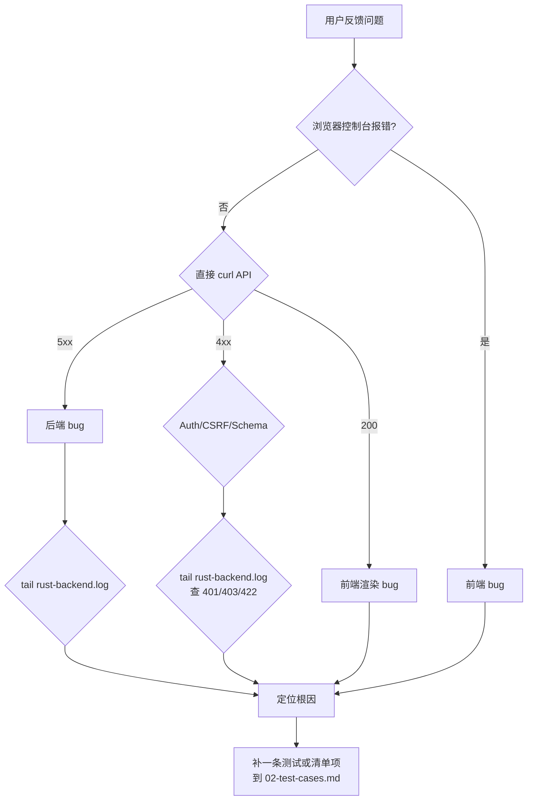

# 1. 故障排查

> English: [01-troubleshooting.md](../01-troubleshooting.md)

其他文档描述系统*应该*如何工作。本页讲它*不*工作的时候该
怎么办。每个小节给出症状、第一条要 grep 的日志、最可能的
原因、以及恢复命令。

## 1.1 处置顺序



三件先做的事,**按顺序**:

1. `GET /healthz` —— 不返回 `200` 的话,进程死了或 DB 不通。
   其他都白搭。
2. `tail -f /var/log/fintech-pioneers/api.log` —— 大多数失败
   会写一条带 request id 的 `level=…` 结构化行。
3. `tail -f /var/log/fintech-pioneers/web.log` —— Next.js
   写 HMR 错误、缺 import、以及 `error.tsx` 边界的 digest。

## 1.2 症状 → 原因 → 处理

### 1.2.1 `/healthz` 返回 502 或超时

| 第一条日志 | 最可能原因 | 处理 |
|---|---|---|
| `connection refused`(API 日志) | API 未运行 | `systemctl status fintech-pioneers-api`;`journalctl -u fintech-pioneers-api -n 50` |
| `sqlx: error returned from database: FATAL: password authentication failed for user "fintech"` | `DATABASE_URL` 错或密码已轮换 | `sudo -u postgres psql -c "\password fintech"`;更新 `/etc/fintech-pioneers/api.env`;`systemctl restart fintech-pioneers-api` |
| `sqlx: error returned from database: FATAL: database "bankpilot" does not exist` | DB 未创建 | `sudo -u postgres psql -c "CREATE DATABASE bankpilot OWNER fintech;"` |
| `connection to server …:5432 refused` | Postgres 未运行 | `systemctl status postgresql` |
| 反代侧 `TLS error` | 证书过期 | `certbot renew`;`nginx -t && systemctl reload nginx` |
| `EADDRINUSE 0.0.0.0:8080` | 旧进程占着端口 | `ss -tnlp 'sport = :8080'`;`kill <pid>`;重启单元 |

### 1.2.2 `GET /` 返回 200 但页面全空

| 第一条日志 | 原因 | 处理 |
|---|---|---|
| `Module not found: Can't resolve '@/i18n/LanguageProvider'`(前端日志) | 部分编辑后缺 import | 补 import;HMR 会重建。Next.js `error.tsx` 边界把它呈现为 "SOMETHING BROKE" —— 补上 import 后边界会释放。 |
| `Hydration mismatch` | SSR HTML 与首次客户端渲染不一致 | 最常见:在 render 阶段读 `localStorage`。把读操作移到 `useEffect`。`LanguageProvider` 已经这样做了;新代码请遵循同一模式。 |
| `TypeError: t is not a function` | 页面在 `<LanguageProvider>` 之外调用了 `useT()` | 用 provider 包住(在 `app/layout.tsx`),或从 `useLanguage()` 取 `t` |

### 1.2.3 登录失败提示 "Invalid CSRF token"

| 原因 | 处理 |
|---|---|
| 浏览器在 `http://`,但 cookie 是 `https://` 下用 `Secure; SameSite=Lax` 设的 | 反向代理必须设 `X-Forwarded-Proto https`(上文 nginx 配置已包含) |
| 两个标签页,其中一个在别的 origin | session cookie 是单 origin 的,只留一个标签页 |
| session 已过期(24h) | 重新登录 |

### 1.2.4 `chat` 页一直转圈

| 第一条日志 | 原因 | 处理 |
|---|---|---|
| `llm: Unsloth unavailable, falling back to stub` | `UNSLOTH_URL` / `UNSLOTH_API_KEY` 错,或 LLM 宕了 | 检查环境变量;从 API 主机 `curl` LLM URL。stub 总会返回 proposal;聊天仍能用,只是文字没那么顺。 |
| `error sending request for url (…)` | 网络/DNS 到 LLM 不通 | 同上;在 API 主机 `curl -v "$UNSLOTH_URL"` |
| `propose_unsloth: timeout` | LLM 慢/卡 | `llm_http` 客户端有超时;若太短就在 `Settings` 里调大。聊天会回退到 stub,用户看到小"offline stub"角标。 |
| `parse error: expected value` | LLM 返回了非 JSON | 提案解析失败。stub 接管,用户看到通用回复。 |

### 1.2.5 转账确认报 "your draft has changed"

这是**预期**行为 —— `parameter_hash` 已对不上,因为 LLM 提案
(或用户)改了一个值。无需修复;让用户重新确认。若每次都
这样:

- 聊天每次刷新都给出不同的 plan。Planner 行为正确;LLM 本就
  非确定性。
- 前端可能留着上一轮的 `confirmation_card`。重新用最新服务端
  状态渲染聊天。

### 1.2.6 挂起动作过期

`pending_actions.expires_at` 已过。用户必须重新确认。若过于
频繁:

- 调高 `PENDING_ACTION_TTL_SECONDS`。
- 默认 5 分钟,对人工点按够长,对被遗弃的 UI 也不会一直挂
  着。

### 1.2.7 触发日上限

`policy::check_daily_limit` 返回 Red。聊天显示"会超过今日
上限"以及 `risk_tier = Red` 的确认卡。用户可以:

- 等到 UTC 0 点(按 UTC 自然日计)。
- 拆成小笔 —— 但**同一上限**适用,所以也会被拦。
- 让 admin 给该账户调高 `DAILY_LIMIT_FEN`。

### 1.2.8 订阅检测无结果

种子把明显的周期扣款标为 `active`,其余留空。检测需要回看
窗口内 ≥ 3 笔、间隔一致。若你的 demo 数据不是种子生成的,
可以 UI 触发(`/subscriptions` 页 → "Run detection"),或:

```bash
curl -X POST https://fintec.example/api/v1/subscriptions/detect \
    -H "Cookie: bp_session=…"
```

### 1.2.9 管理员规则拦了本该通过的动作

```bash
# 查命中的规则。
sudo -u postgres psql -d bankpilot -c "\
  SELECT id, kind, name, pattern, severity, enabled \
  FROM agent_rules WHERE enabled = true ORDER BY kind;"

# 软禁用规则(不删除)。
sudo -u postgres psql -d bankpilot -c "\
  UPDATE agent_rules SET enabled = false, notes = COALESCE(notes,'')||E'\n[disabled '||NOW()::text||']' WHERE id = 'rule_id';"
```

正确做法是**编辑规则**而非删除 —— 审计日志引用了 rule id,
留 trail 利于阅读。

### 1.2.10 审计链 verify 失败

```bash
cargo run --release --bin bankpilot -- audit verify
```

若返回 `mismatch at row N`,**立刻停掉 API** 再排查 —— 说明
有人或某进程在绕过权限写 `audit_events`。生产中:

1. `REVOKE UPDATE, DELETE ON audit_events FROM fintech;` ——
   强制该角色仅追加。
2. 找到执行该变更的运维或 job。
3. 哈希链已断,出错行之后的所有行都不可信。从出错之前的
   备份恢复。

当前 build 没有 `audit verify` 的 CLI;上面是推荐形态,实现是
`backendrust/src/audit.rs` 里的 `audit::verify_chain`。

## 1.3 日志行目录

最有用的 `grep` 模板。Rust 侧都过 `RUST_LOG`,默认 `info`。

| 模板 | 含义 | 何时该动手 |
|---|---|---|
| `bankpilot \| llm: using Unsloth proposal` | LLM 响应成功 | 无 —— happy path |
| `bankpilot \| llm: Unsloth unavailable, falling back to stub` | LLM 调用失败,跑 regex stub | 排查 LLM URL / key / 网络 |
| `transfer.confirm ok` | 一笔转账已确认并入账 | 无 |
| `policy: tier=Red reason=…` | 决定为 Red | 审计该行;若非预期,看 flags |
| `agent_rule.match id=rule_…` | 一条 admin 规则命中 | 预期则无;非预期则排查 |
| `fraud_guard: hard_signal=true` | 一笔转账被反诈卫士升级 | 审计该行;用户看到 Red 确认卡 |
| `audit: chain verify mismatch` | 检测到篡改 | **寻呼** —— 见 §1.2.10 |
| `executor: node … failed: …` | 工作流节点报错 | 用户看到"重试"按钮;查失败的 tool |
| `safety: lock triggered` | 安全锁触发(MFA 失败等) | 与用户确认;`UPDATE users SET safety_lock_state = 'unlocked' WHERE id = '…';` 清除 |

## 1.4 升级矩阵

| 症状 | 一线处理 | 寻呼 |
|---|---|---|
| 一个用户登不上 | 前端 / L1 客服 | — |
| 整站挂 | SRE / 平台 | 是(> 5 分钟) |
| `audit verify` 不匹配 | 安全 on-call | **立即寻呼** |
| LLM 限流 / 宕 | 无(优雅降级) | 持续 > 30 分钟则寻呼 |
| DB 复制延迟 | DB 管理员 | > 60 秒且该节点有写则寻呼 |
| 证书 < 14 天过期 | 平台 | < 7 天则寻呼 |

## 1.5 接下来读哪里

- [00-deployment.md](./00-deployment.md) —— 需要了解某个
  *流程*(迁移、备份、单元)时。
- [02-test-cases.md](./02-test-cases.md) —— "这块我们测过
  吗?"的问题。
- [../architecture/06-security-design.md](../architecture/06-security-design.md) —— 八层纵深防御。
